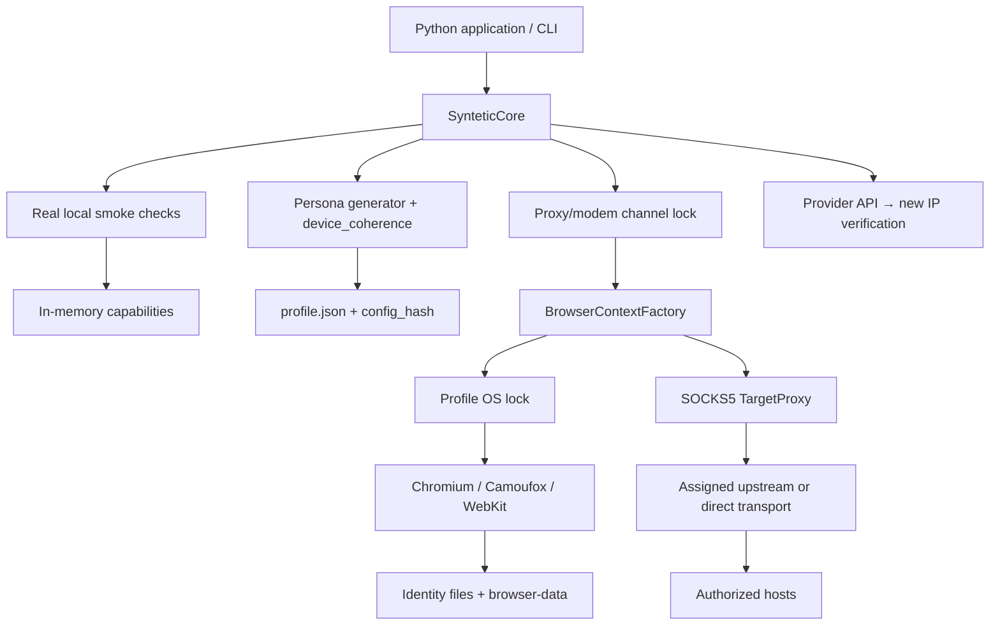

# Syntetic Core architecture

English · [Russian translation](ru/ARCHITECTURE.md)

## Scope

The core is a library and CLI for one process/host with local profiles. It is not a
job queue or distributed server. The calling application manages tasks, overall
concurrency, and scheduling.



## Package layers

| Layer | Responsibility |
|---|---|
| `core.py` | Persistent profiles, public sessions, lifecycle, and boundary checks |
| `proxy.py` | Provider protocol, HTTP adapter, channel locking, IP confirmation |
| `cli.py` | Explicit preparation, doctor, profile creation, page probe |
| `_engine/personas.py` | Extracted Pydantic models and validation rules |
| `_engine/persona_randomization.py` | Device family, runtime, OS, and parameter selection |
| `_engine/device_coherence.py` | Linked hardware recipes and conflict detection |
| `_engine/capabilities.py` | Real browser checks and feature admission |
| `_engine/browser/factory.py` | Shared browser launch and context validation |
| `_engine/browser/chromium.py` | CDP UA/CH, CPU, Workers, touch, and native sensors |
| `_engine/browser/native.py` | Persistent Camoufox fingerprint/config |
| `_engine/browser/device_emulation.*` | Python configuration and JavaScript API implementation |
| `_engine/browser/content_filter.py` | Chromium MV3, Gecko, and native Linux WebKit filters |
| `_engine/actions/behavior.py` | Typing, cursor movement, scrolling, UXActivityDispatcher |

`_engine` stays close to the original structure to support comparison and future
extractions. It is internal; the public contract is defined by `syntetic_core` exports.

## Profile creation

1. Validate the ID and the explicitly requested proxy.
2. Discover local capabilities on first use and cache them in this `SynteticCore` instance.
3. Select an available engine and a coherent device recipe.
4. Apply locale, timezone, and consistent synthetic geolocation.
5. Calculate `config_hash`; validate the final persona with Pydantic and `require_compatible`.
6. Write `profile.json` atomically under an OS lock. Existing profiles are never
   overwritten. Cancellation does not release the lock while the write is still running.

Set identity-defining properties before the first launch of a new profile. The hash
detects accidental corruption or mismatch; it is not a signature against an
administrator who can rewrite the data and recalculate the hash.

## Opening a session

1. Read and validate the saved persona.
2. Check compatibility against the local runtime manifest.
3. Acquire the exclusive proxy channel lock, if applicable. Ports sharing a physical
   modem must share a `proxy_channels` identifier.
4. The factory acquires the profile OS lock and validates runtime-state/identity files.
5. Start loopback TargetProxy. Chromium requires the checked driver patch; Camoufox
   uses its pinned native configuration; WebKit checks the actual host and media support.
6. Install mandatory session APIs and validate the environment before yielding the context.
7. Yield regular Playwright context/page objects and behavior helpers to the application.
8. On exit or exception, close the browser and transport, record runtime-state,
   then release the profile lock and channel lock.

The caller owns the overall task deadline. `browser_start_timeout` bounds startup;
`navigation_timeout` and `action_timeout` bound Playwright operations. Sessions do
not automatically retry external actions.

## Persistent storage

```text
data/profiles/
  .locks/<id>.lock
  .network/...                      # Cross-process proxy channel lock files
  <id>/
    profile.json                    # Persona and checksum
    browser-data/                   # Cookies, localStorage, IndexedDB, engine cache
    runtime-state.json              # Engine, launches, network observations
    canvas-identity.json
    emulation-identity.json          # When explicit emulation is present
    session-hardware-identity.json   # Chromium
    ios-identity.json                # WebKit/iOS
    fingerprints/<fingerprint_id>.json
```

Not every engine creates every file. Reuse requires a compatible browser version.
Do not open the same `browser-data` concurrently outside this API. Copying a live
profile directory is not a consistent backup.

Unlike the source product's November archive pipeline, this local wrapper does not
clear browser caches before packaging: it has no packaging/S3 pipeline. This is an
explicit standalone lifecycle difference; device emulation mechanisms are preserved.

## Early Chromium Worker initialization

Document init scripts do not configure HTTP Client Hints or background Worker
contexts. A separate CDP controller recursively auto-attaches to targets, pauses
startup, applies identity, and resumes execution. The checked driver patch removes
competition with Playwright over target resume/detach ownership.

Public sessions block service workers. Their initialization mechanism remains in
the low-level factory for explicit QA use. Workers do not receive the entire DOM
emulation layer. Firefox/WebKit do not have equivalent early Worker coverage.

## Networking

TargetProxy transfers the browser's TLS bytes over TCP. It checks destinations,
does not create a new ClientHello, and does not implement its own browser TLS
fingerprint. QUIC/HTTP3 is unavailable through this transport. Authorize local/private
targets separately with `trusted_local_target_hosts`; a general allowlist is insufficient.

Provider rotation uses a separate httpx client without ambient proxy settings or
redirects. The IP probe traverses the assigned upstream proxy. It verifies the
TCP/TLS tunnel's exit address, not every aspect of the target site's network behavior.

## Distributed guarantees excluded from this package

OS locks coordinate one host and a shared local directory. Redis quorum leases,
DB fencing, canonical S3 heads, and the source supervisor/cgroups are excluded.
Multiple hosts require an external coordinator. Local locks do not guarantee global
serialization or exactly-once external actions.
