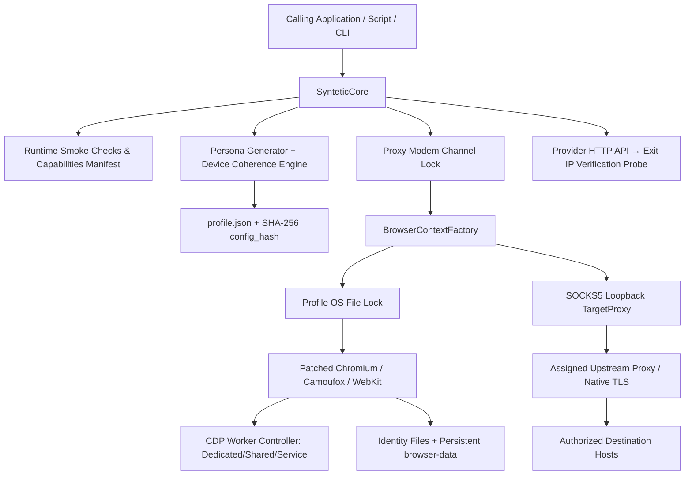

# Syntetic Core Architecture & Anti-Detect Pipeline

English · [Russian translation](ru/ARCHITECTURE.md)

## System Scope

Syntetic Core is an anti-detect browser execution runtime and CLI designed for high-stealth automation on a local host. It extracts the proven anti-fraud bypass capabilities from an enterprise behavioral factors (ПФ) production platform into a modular, self-contained library.

Concurrency, task orchestration, and overall task scheduling are managed by the calling application.



---

## Package Architecture

| Module / Package | Anti-Detect Responsibility |
|---|---|
| `core.py` | Public `SynteticCore` API, persistent profile lifecycle, session boundaries, and domain allowlists |
| `proxy.py` | Proxy configuration, HTTP rotation provider, modem channel locking, and exit IP confirmation |
| `cli.py` | CLI commands: `prepare` (driver patching), `doctor` (stealth discovery), `create`, and `open` |
| `_engine/personas.py` | Pydantic persona models, hardware validation rules, and schema definitions |
| `_engine/persona_randomization.py` | Deterministic generation of realistic device presets, OS versions, and parameter pools |
| `_engine/device_coherence.py` | Multi-property coherence engine ensuring GPU, CPU, screen, DPR, and Client Hints match 100% |
| `_engine/capabilities.py` | Local runtime capability discovery (verifying real browser binary stealth features) |
| `_engine/browser/factory.py` | Browser context initialization, TargetProxy setup, and environment verification |
| `_engine/browser/chromium.py` | Chromium CDP integration: Client Hints, CPU, RAM, Battery, and native sensor overrides |
| `_engine/browser/playwright_worker_control.py` | Early CDP worker interception: auto-attaches and patches Dedicated/Shared/Service/Nested Workers |
| `_engine/browser/native.py` | Camoufox integration: persistent C++ engine fingerprints and configurations |
| `_engine/browser/device_emulation.*` | JavaScript anti-detect scripts: Canvas text shifts, WebGL spoofs, and `[native code]` shims |
| `_engine/browser/content_filter.py` | Network resource filtering (Chromium MV3 declarativeNetRequest, Gecko, and Linux WebKit) |
| `_engine/actions/behavior.py` | Human-like behavioral factor simulation: Bezier mouse paths, typing cadence, and inertial scrolling |

---

## Profile Creation Pipeline

1. **Host & Proxy Verification:** Validates profile ID and ensures the assigned proxy exists in configuration.
2. **Capability Discovery:** Runs on first launch to detect installed browser binaries, OS capabilities, and valid stealth modules. Results are cached in-memory.
3. **Coherent Recipe Selection:** Selects a realistic device preset from the 1000+ catalog, aligning OS, GPU, CPU, screen dimensions, DPR, and Client Hints architecture.
4. **Localization & Geolocation:** Applies consistent language, timezone, and city-centered coordinates.
5. **Deterministic Seeds:** Generates and locks seeds for Canvas 2D text shifts, audio noise, and hardware IDs.
6. **Hash & Persistence:** Calculates `config_hash` and atomically writes `profile.json` under an OS-level file lock (`ProfileLock`). Existing profiles are never overwritten.

---

## Session Launch & Anti-Detect Injection

1. **Validation:** Reads `profile.json`, verifies the SHA-256 hash, and checks compatibility against runtime capabilities.
2. **Proxy Channel Locking:** If using a mobile proxy, acquires an exclusive OS lock for the modem channel (`proxy_channels`) to prevent concurrent usage of the same cellular modem.
3. **Profile File Lock:** Acquires an exclusive file lock on `data/profiles/<id>/.locks/<id>.lock`.
4. **TargetProxy Setup:** Initializes the loopback SOCKS5 gateway enforcing host allowlisting while delegating TLS handshakes to the native browser.
5. **Browser Startup & Patching:**
   - **Chromium:** Launches with the patched Playwright driver; attaches the CDP Worker Controller to auto-intercept and patch all background threads.
   - **Camoufox:** Launches with pinned anti-detect C++ build and persistent native profile seeds.
   - **WebKit:** Launches native WebKit on Linux/macOS with validated media decoders.
6. **Pre-Navigation Injection:** Injects JavaScript anti-detect layers (`device_emulation.js`, `native_functions.js`) into all main frames and iframes before any document script executes.
7. **Session Yield:** Yields standard Playwright `page` and `context` objects along with the `session.behavior` helper.
8. **Teardown:** On session close, captures updated `browser-data` (cookies, storage, cache), flushes runtime state, closes proxies, and releases all OS locks.

---

## Persistent Storage Layout

```text
data/profiles/
  .locks/<id>.lock                     # Cross-process OS profile lock
  .network/...                         # Cross-process modem channel locks
  <id>/
    profile.json                       # Persona parameters and SHA config_hash
    browser-data/                      # Persistent cookies, localStorage, IndexedDB, disk cache
    runtime-state.json                 # Launch history, observed exit IPs, and run statistics
    canvas-identity.json               # Profile-specific Canvas 2D subpixel noise seed
    emulation-identity.json            # Hardware and WebGL parameters
    session-hardware-identity.json     # Chromium CPU, RAM, and Battery state
    ios-identity.json                  # WebKit / iOS specific identifiers
    fingerprints/<fingerprint_id>.json # Camoufox native engine state
```

Cookies and storage are preserved directly in `browser-data/`. Reopening a profile continues the browser session with accumulated history, trust scores, and active authentication.

---

## Early WebWorker Interception

Conventional browser automation tools fail against advanced anti-bots (such as Cloudflare Turnstile and DataDome) because anti-bot scripts query `navigator` and `OffscreenCanvas` from background WebWorkers where standard `page.add_init_script` cannot reach.

Syntetic Core implements a recursive **CDP Worker Controller**:
- Uses Chrome DevTools Protocol `Target.setAutoAttach` with `waitForDebuggerOnStart: true`.
- Intercepts DedicatedWorkers, SharedWorkers, ServiceWorkers, and NestedWorkers before the first line of worker script executes.
- Injects hardware concurrency, device memory, User-Agent, platform, Client Hints, and WebGL offscreen canvas configuration.
- Resumes the worker target only after all anti-detect overrides are active.

---

## Network Stealth & Native Browser TLS

- **Native TLS Negotiation:** The browser itself negotiates the TLS session over a local SOCKS5 TCP tunnel. This ensures that JA3, JA4, and TLS extension fingerprints match genuine Chrome, Firefox, or Safari, avoiding the detectable TLS signatures of Python/Go HTTP libraries.
- **Strict Host Allowlist:** `allowed_target_hosts` enforces strict destination control, blocking unauthorized tracker or leak requests.
- **Modem Channel Serialization:** Mobile proxy ports sharing the same physical cellular modem are assigned a common channel ID, ensuring that IP rotation serializes correctly without breaking active sessions.
- **Exit IP Verification Probe:** IP rotation via provider HTTP APIs is validated by an independent HTTP probe confirming a changed public exit IP before handing control back to the application.
