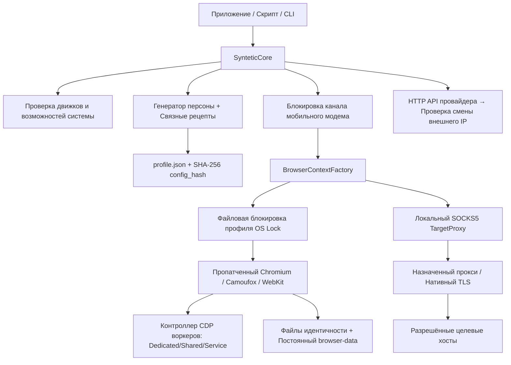

# Архитектура и контур антидетект-защиты Syntetic Core

[English](../ARCHITECTURE.md) · Русская версия

## Границы и назначение системы

Syntetic Core — это локальное антидетект-ядро и консольная утилита для запуска скрытных, недетектируемых браузерных сессий. Проект переносит передовые наработки по обходу антифрода из производственного контура накрутки поведенческих факторов («ПФ») в автономную библиотеку.

Ядро выполняется локально: управление параллельностью, очередями задач и общим расписанием реализуется на уровне вызывающего приложения.



---

## Слои пакета и их роли в защите от детекта

| Модуль / Пакет | Роль в контуре антидетекта |
|---|---|
| `core.py` | Публичный интерфейс `SynteticCore`, жизненный цикл постоянных профилей, границы сессий и белые списки хостов |
| `proxy.py` | Настройка прокси, универсальный HTTP-провайдер ротации, блокировка аппаратных модемов и зонд проверки IP |
| `cli.py` | Консольные команды: подготовка браузера с патчем (`prepare`), диагностика (`doctor`), создание и открытие профилей |
| `_engine/personas.py` | Pydantic-модели профилей устройств, правила валидации и схемы данных |
| `_engine/persona_randomization.py` | Генерация реалистичных конфигураций устройств, версий ОС и параметров окружения |
| `_engine/device_coherence.py` | Движок связности параметров: исключает невозможные сочетания GPU, CPU, экрана, DPR и Client Hints |
| `_engine/capabilities.py` | Проверка локальных браузерных бинарников и доступных механизмов подмены |
| `_engine/browser/factory.py` | Инициализация контекста браузера, запуск TargetProxy и предстартовая проверка stealth-слоя |
| `_engine/browser/chromium.py` | Интеграция с Chromium через CDP: Client Hints, ядра CPU, память RAM, батарея и мобильные сенсоры |
| `_engine/browser/playwright_worker_control.py` | Ранний перехват воркеров через CDP: автоподключение и подмена параметров в Dedicated/Shared/Service Workers |
| `_engine/browser/native.py` | Интеграция с Camoufox: нативные постоянные отпечатки и конфигурации движка C++ |
| `_engine/browser/device_emulation.*` | JavaScript-слой защиты: сдвиг Canvas 2D, подмена WebGL и маскировка функций под `[native code]` |
| `_engine/browser/content_filter.py` | Фильтрация ресурсов на уровне сети (Chromium MV3 declarativeNetRequest, Gecko и WebKit) |
| `_engine/actions/behavior.py` | Поведенческий модуль (ПФ): движения мыши по кривым Безье, набор текста с задержками и опечатками, скроллинг |

---

## Процесс создания профиля

1. **Проверка входных данных:** Валидация идентификатора профиля и проверка наличия назначенного прокси в настройках.
2. **Диагностика окружения (Capability Discovery):** При первом обращении проверяет доступные браузерные движки и активные модули подмены отпечатков. Результат кэшируется в памяти.
3. **Выбор связного рецепта:** Из каталога (>1000 пресетов) выбирается согласованная модель устройства, где видеокарта, процессор, разрешение, плотность пикселей (DPR) и Client Hints соответствуют реальному физическому устройству.
4. **Локализация и геопозиция:** Назначаются язык, часовой пояс и синтетические координаты, привязанные к центрам городов выбранного часового пояса.
5. **Генерация сидов (Seeds):** Фиксируются уникальные сиды для сдвига Canvas 2D, шума Web Audio и аппаратных идентификаторов.
6. **Атомарная запись с блокировкой:** Рассчитывается контрольная сумма `config_hash`, и профиль `profile.json` атомарно записывается под блокировкой операционной системы (`ProfileLock`).

---

## Запуск сессии и внедрение защиты

1. **Проверка целостности:** Чтение `profile.json`, проверка SHA-256 хеша и валидация на совместимость с текущим окружением.
2. **Блокировка модема:** При использовании мобильного прокси захватывается эксклюзивная блокировка физического канала модема (`proxy_channels`), предотвращая одновременную работу через один модем.
3. **Блокировка профиля:** Захват файловой блокировки `data/profiles/<id>/.locks/<id>.lock`.
4. **Запуск TargetProxy:** Поднятие локального шлюза SOCKS5, проверяющего белый список хостов и делегирующего TLS-рукопожатие браузеру.
5. **Старт браузера с патчем:**
   - **Chromium:** Запускается с пропатченным драйвером Playwright; активируется контроллер CDP воркеров для перехвата фоновых потоков.
   - **Camoufox:** Запускается нативная сборка с аппаратной защитой отпечатков.
   - **WebKit:** Запуск нативного WebKit на Linux/macOS с проверкой медиадекодеров.
6. **Инжекция скриптов маскировки:** Внедрение JS-скриптов (`device_emulation.js`, `native_functions.js`) во все фреймы до выполнения любого стороннего кода страницы.
7. **Передача сессии:** Возврат вызывающему коду стандартных объектов Playwright `page`, `context` и инструмента поведенческих факторов `session.behavior`.
8. **Завершение и сохранение:** Закрытие страниц, синхронизация каталога `browser-data` (сохранение cookies, кэша и хранилищ), сброс состояния сети и освобождение всех файловых блокировок.

---

## Структура постоянного хранилища профиля

```text
data/profiles/
  .locks/<id>.lock                     # Межпроцессная блокировка профиля OS Lock
  .network/...                         # Межпроцессные блокировки каналов модемов
  <id>/
    profile.json                       # Параметры устройства и контрольный хеш config_hash
    browser-data/                      # Постоянные cookies, localStorage, IndexedDB, дисковый кэш
    runtime-state.json                 # История сессий, наблюдаемые внешние IP и статистика
    canvas-identity.json               # Профильный сид для сабпиксельного сдвига Canvas 2D
    emulation-identity.json            # Параметры железа и видеокарты WebGL
    session-hardware-identity.json     # Данные процессора, памяти и батареи Chromium
    ios-identity.json                  # Идентификаторы для WebKit / iOS
    fingerprints/<fingerprint_id>.json # Нативное состояние профиля Camoufox
```

Cookies и локальные данные браузера сохраняются напрямую в `browser-data/`. При следующем запуске сессия продолжается с накопленной историей, доверием антифрода (trust score) и активной авторизацией на сайтах.

---

## Ранний перехват WebWorkers

Стандартные библиотеки автоматизации легко детектируются современными защитами (например, Cloudflare Turnstile и DataDome), так как скрипты защиты создают фоновые WebWorkers и считывают свойства `navigator` и контекста `OffscreenCanvas` из потока, куда обычный `add_init_script` не имеет доступа.

В Syntetic Core реализован рекурсивный **CDP Worker Controller**:
- Использует команду Chrome DevTools Protocol `Target.setAutoAttach` с флагом `waitForDebuggerOnStart: true`.
- Перехватывает создание DedicatedWorkers, SharedWorkers, ServiceWorkers и NestedWorkers до выполнения первой строчки скрипта воркера.
- Внедряет согласованные параметры ядер процессора, оперативной памяти, User-Agent, платформы, Client Hints и настроек WebGL.
- Снимает воркер с паузы только после того, как его цифровой отпечаток полностью приведен в соответствие с основным окном браузера.

---

## Сетевой уровень и нативный браузерный TLS

- **Нативный TLS-стек браузера:** Браузер сам выполняет TLS-рукопожатие через локальный TCP-туннель SOCKS5. Это сохраняет настоящие браузерные отпечатки JA3, JA4 и расширения TLS реального браузера, исключая характерные аномалии библиотек Python и Go.
- **Строгий белый список доменов:** Параметр `allowed_target_hosts` жестко ограничивает сетевой доступ, блокируя непредвиденные трекеры и утечки.
- **Сериализация каналов модемов:** Несколько портов прокси, физически использующих один USB-модем, объединяются общим идентификатором канала, что предотвращает конфликтную ротацию во время активных сессий.
- **Проверка смены IP (Exit IP Verification):** Ротация через API провайдера считается завершённой только после успешного ответа внешнего тестового зонда, подтвердившего смену публичного IP.
