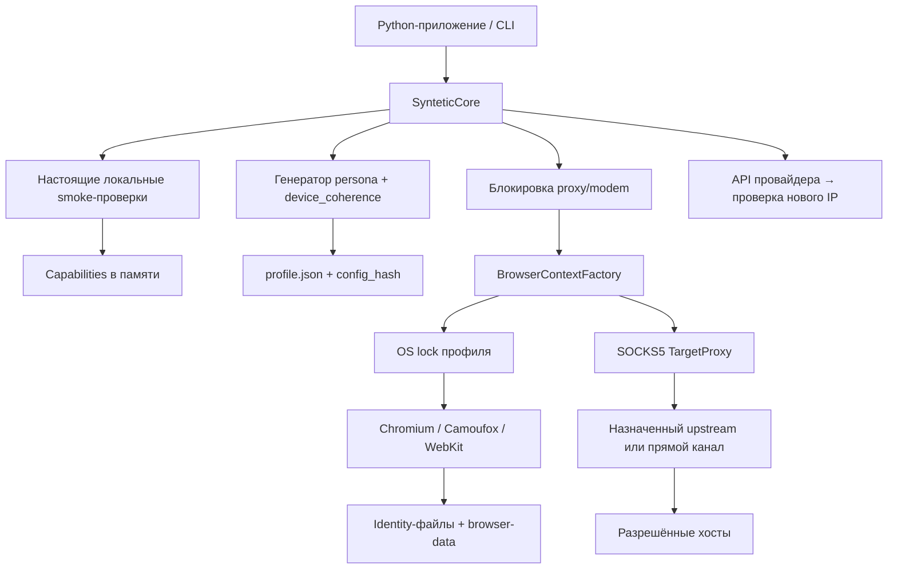

# Архитектура Syntetic Core

[English](../ARCHITECTURE.md) · Русская версия

## Границы

Это библиотека и CLI для одного процесса/хоста с локальными профилями. Ядро не
является очередью заданий или распределённым сервером. Масштабирование выполняет
вызывающее приложение: оно управляет задачами, общей параллельностью и расписанием.



## Слои пакета

| Слой | Ответственность |
|---|---|
| `core.py` | Постоянные профили, публичная сессия, lifecycle и проверки границ |
| `proxy.py` | Протокол провайдера, HTTP-адаптер, блокировка канала, подтверждение IP |
| `cli.py` | Явная подготовка, doctor, создание профиля, открытие страницы |
| `_engine/personas.py` | Перенесённые Pydantic-модели и правила валидации |
| `_engine/persona_randomization.py` | Выбор семейства, runtime, ОС и параметров |
| `_engine/device_coherence.py` | Связанные аппаратные рецепты и проверка конфликтов |
| `_engine/capabilities.py` | Проверка настоящих браузеров и допускаемых возможностей |
| `_engine/browser/factory.py` | Общая точка запуска и проверки контекста |
| `_engine/browser/chromium.py` | UA/CH, CPU, Workers, touch и нативные датчики через CDP |
| `_engine/browser/native.py` | Сохранённый Camoufox fingerprint/config |
| `_engine/browser/device_emulation.*` | Python-конфигурация и JS-реализация API |
| `_engine/browser/content_filter.py` | Chromium MV3, Gecko и нативный Linux WebKit-фильтр |
| `_engine/actions/behavior.py` | Ввод, курсор, прокрутка и UXActivityDispatcher |

`_engine` сохраняет близкую к исходной структуру для сверки и последующих переносов.
Он внутренний: стабильный внешний контракт определяется экспортами `syntetic_core`.

## Создание профиля

1. Проверяется ID и наличие явно запрошенного прокси.
2. Первый вызов запускает capability discovery. Результат сохраняется в памяти
   конкретного `SynteticCore`; последующие вызовы его переиспользуют.
3. Генератор выбирает доступный движок и согласованный рецепт устройства.
4. Применяются язык, timezone и согласованная синтетическая геолокация.
5. Вычисляется `config_hash`; повторная Pydantic-валидация и `require_compatible`
   проверяют итоговую persona.
6. Под OS lock атомарно записывается `profile.json`. Существующий профиль не
   перезаписывается. Отмена не освобождает lock до окончания файловой записи.

Изменяемые характеристики должны задаваться до первого запуска новой идентичности.
Хеш обнаруживает случайную порчу/расхождение, но не является подписью против
администратора, который может переписать данные и пересчитать хеш.

## Открытие сессии

1. Читается и проверяется сохранённая persona.
2. Проверяется совместимость с локальным runtime manifest.
3. Если есть прокси, берётся эксклюзивный OS lock канала. Для нескольких портов
   одного модема задаётся общий `proxy_channels` идентификатор.
4. Фабрика берёт отдельный OS lock профиля, проверяет runtime-state и файлы identity.
5. Запускается loopback TargetProxy. Chromium получает проверенный driver patch,
   Camoufox — закреплённую нативную конфигурацию, WebKit — проверку host/media.
6. До выдачи контекста устанавливаются общие session API и проверяется среда.
7. Вызывающее приложение получает обычные Playwright context/page и инструменты behavior.
8. При выходе/исключении браузер и транспорт закрываются, сохраняется runtime-state,
   затем освобождаются lock профиля и lock канала.

Внешнее приложение отвечает за общий deadline задачи. Бюджет запуска ограничен
`browser_start_timeout`; `navigation_timeout` и `action_timeout` ограничивают
операции Playwright. Сессии не повторяют сторонние действия автоматически.

## Постоянные данные

```text
data/profiles/
  .locks/<id>.lock
  .network/...                 # файлы межпроцессной блокировки proxy-каналов
  <id>/
    profile.json               # persona и контрольная сумма
    browser-data/              # cookies, localStorage, IndexedDB, cache движка
    runtime-state.json         # движок, история запусков, сетевые наблюдения
    canvas-identity.json
    emulation-identity.json     # когда есть явная emulation
    session-hardware-identity.json  # Chromium
    ios-identity.json           # WebKit/iOS
    fingerprints/<fingerprint_id>.json
```

Не каждый движок создаёт все файлы. Повторное использование требует согласованной
версии браузера. Не открывайте один `browser-data` одновременно из другого процесса
в обход API. Простое копирование живого каталога не является согласованным backup.

В отличие от ноябрьского архивного конвейера исходного продукта, локальная оболочка
не очищает браузерные кэши перед упаковкой: упаковки/S3 здесь нет. Это явное
отличие самостоятельного жизненного цикла; аппаратные механизмы сохранены.

## Ранние Chromium Workers

Документный init-script не задаёт HTTP Client Hints и окружение фоновых потоков.
Отдельный CDP controller рекурсивно auto-attach-ится к targets с удержанием старта,
применяет идентичность и разрешает исполнение. Копия проверенного driver patch
устраняет конкуренцию с Playwright за resume/detach этих targets.

В публичной сессии service workers заблокированы. Механизм их инициализации сохранён
в низкоуровневой фабрике для явных QA-применений. Полная DOM-эмуляция в Workers
не выполняется. У Firefox/WebKit нет эквивалентного охвата ранней настройки Workers.

## Сеть

TargetProxy переносит байты браузерного TLS через TCP. Он проверяет назначения,
не создаёт новый ClientHello и не реализует собственный браузерный TLS-отпечаток.
QUIC/HTTP3 через этот путь отсутствует. Разрешённые приватные/local адреса задаются
отдельно через `trusted_local_target_hosts` — одного общего allowlist недостаточно.

HTTP-ротация провайдера выполняется отдельным httpx-клиентом без ambient proxy и
без редиректов. Проверка адреса идёт через upstream назначенного прокси. Это
проверка выхода TCP/TLS-туннеля, а не полная проверка сетевого поведения сайта.

## Отсутствующие распределённые гарантии

OS locks действуют на одном хосте и общем локальном каталоге. Redis quorum leases,
DB fencing, canonical S3 heads и supervisor/cgroups исходной системы не перенесены.
Для нескольких машин требуется внешний координатор. Не используйте локальные lock
как обещание глобальной сериализации или exactly-once внешних действий.
